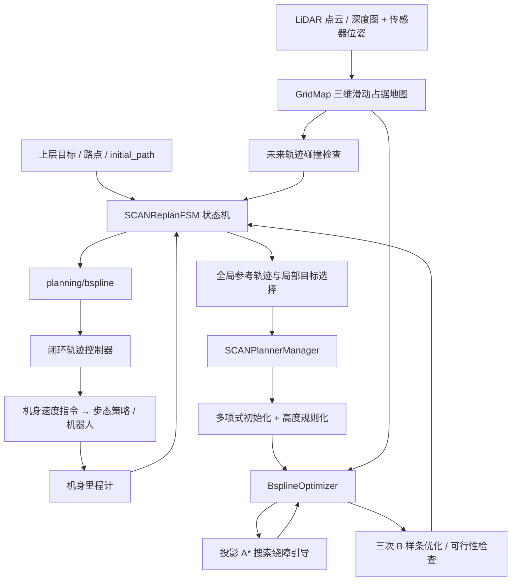
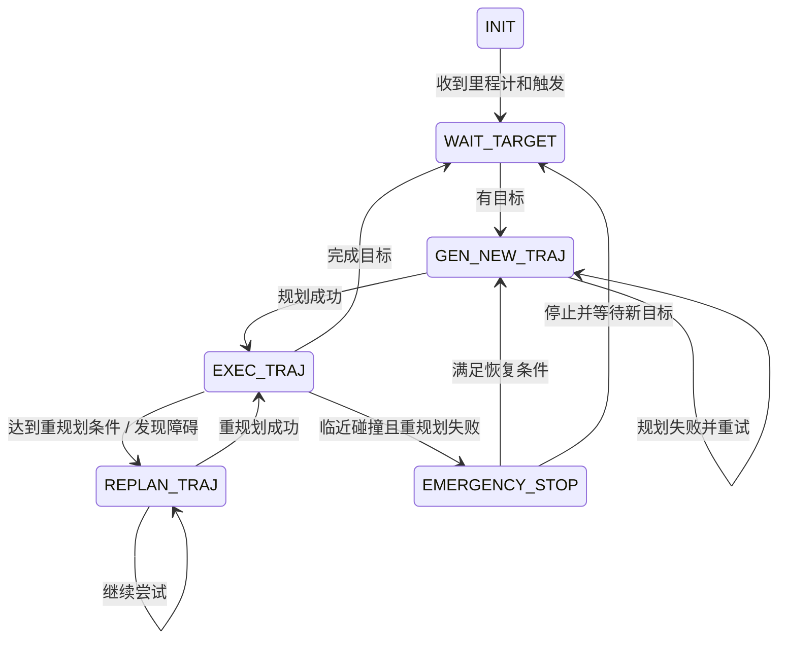

# SCAN-Planner 代码架构与论文对照

本文解读当前服务器实际部署版本。源码根目录：`/home/hexiao/3d-navigation/third_party/legbot-3d-navi/src/SCAN-Planner`。

用户提供的 `D:\大四\毕设\论文\SCAN-Planner.pdf` 位于 Windows，本服务器无法直接读取。本文使用仓库 README 所链接的公开论文 [SCAN-Planner: Spatial Collision-Aware Local Planning for Route-Guided Long-Range Quadruped Navigation](https://arxiv.org/html/2606.19555)。公开论文 PDF 已保存在 `runs/scanplanner/architecture/SCAN-Planner.pdf`，HTML 和提取文本同目录保存；尚未核实它与用户本地 PDF 是否为同一修订版。

## 1. 系统定位

SCAN-Planner 负责“给定路线/目标、里程计和局部观测，生成机身可安全通过的平滑局部轨迹”。其主算法是 C++/ROS 的几何搜索与数值优化，不需要神经网络权重。

这里要区分三层：

1. 上层任务/路线层：决定去哪里，给出目标、路点或参考路径。可以是人工指定、全局规划器、探索系统或视觉语言导航系统。
2. SCAN 局部规划层：沿参考路线选择局部目标，结合实时地图绕障，输出时间参数化 B 样条。
3. 跟踪和运动层：控制机身速度、姿态和关节，真正把轨迹执行出来。

因此“机器人能绕过箱子”和“机器人能稳定迈腿”分别涉及第 2 层和第 3 层，不能把步态能力归给 SCAN 的 B 样条优化器。

## 2. 数据流与模块关系



这些规划模块大多是一个 `scan_planner_node` 进程内的 C++ 对象，不是每个目录都单独启动一个 ROS 节点。控制器、传感器模拟器和仿真桥通常是独立节点/进程。

## 3. 目录与论文概念对照

| 模块 | 关键文件 | 负责什么 | 论文对应 |
|---|---|---|---|
| 入口 | `plan_manage/src/scan_planner_node.cpp` | 创建状态机，进入 ROS 回调循环 | §III 系统架构 |
| 规划调度 | `plan_manage/src/scan_replan_fsm.cpp` | 接收目标、维护状态、选局部目标、重规划和安全处理 | §III、§IV 的在线流程 |
| 规划编排 | `plan_manage/src/planner_manager.cpp` | 初始化、B 样条参数化、优化、时间重分配、结果保存 | §IV-A、§IV-C |
| 地图 | `plan_env/src/grid_map.cpp` 和 `include/plan_env/grid_map.h` | 占据概率更新、滑动窗口、增量膨胀、方向相关碰撞查询 | §IV-B、§V-A |
| 搜索 | `path_searching/src/dyn_a_star.cpp` | 在插值高度曲面上搜索局部绕障引导 | §V-B |
| 优化 | `bspline_opt/src/bspline_optimizer.cpp` | 碰撞段检测、反弹方向、平滑/避障/可行性代价 | §IV-C |
| 曲线工具 | `bspline_opt/src/uniform_bspline.cpp` | B 样条求值、导数、拟合、可行性与时间调整 | §IV-A |
| 多项式工具 | `traj_utils/src/polynomial_traj.cpp` | 初始多项式和参考轨迹 | §IV-C1 |
| 可视化 | `traj_utils/src/planning_visualization.cpp` | 初始化、A*、最优轨迹的 RViz Marker | 调试辅助 |
| 跟踪控制 | `plan_manage/src/closed_loop_controller.cpp` | B 样条 + 实际里程计 → 机身速度 | 论文的轨迹执行接口 |

以上相对路径均从源码根目录下的 `src/planner/` 开始。

## 4. 入口和状态机：什么时候规划

入口文件仅创建 `SCANReplanFSM`，调用 `init()`，最后 `ros::spin()`。真正的主程序是状态机及其 ROS 回调。

`SCANReplanFSM::init()` 中有两个关键定时器：

- `execFSMCallback`：周期 0.01 s，即名义 100 Hz，管理状态转换。
- `checkCollisionCallback`：周期 0.05 s，即名义 20 Hz，检查未来轨迹是否因新障碍而失效。

这不代表完整优化器每秒一定运行 100 次；实际调用由状态、阈值、回调耗时共同决定。

状态流：



`getLocalTarget()` 先将当前位置投影到参考轨迹附近，再向前累计弧长，选择规划视野距离处的局部目标。当前版本还会在局部目标占据时，沿参考轨迹前后搜索替代点。

长程导航靠“不断向前选局部目标 + 滑动地图 + 滚动重规划”完成，不是一次把几公里路径变成一条巨大 B 样条。

## 5. 三维地图与双圆柱碰撞模型

### 5.1 为什么保留三维占据

论文 §III、§V-A 强调局部三维占据地图。二维平面投影难以区分桌面、桌下空隙、台阶与悬空结构。三维地图能保留它们不同的高度占据。

`GridMap` 的主要数据路径：

- LiDAR：`cloudCallback()`；
- 深度：`depthPoseCallback()`、`projectDepthImage()`；
- 射线：`raycastProcess()`；
- 更新：`applyOccupancyUpdate()`；
- 滑动：`updateSlidingMap()`；
- 膨胀：`updateInflationLayer()`、`rebuildInflationOffsets()`。

射线经过处倾向空闲，命中处倾向占据，以 log-odds 累加并截断。这是观测地图，不是已知的全局真值地图；遮挡、稀疏点云、位姿误差都会影响它。

### 5.2 为什么滑动

地图使用固定大小局部窗口，随机器人移动更新。环形缓冲通过循环地址复用存储，保留重叠区域、清理移出区域，避免每次移动复制整个三维数组。内存随局部窗口大小变化，不随走过的总距离无限增长。

占据改变时增量更新膨胀层，减少整张地图重建的开销。

### 5.3 双圆柱的实质

论文 §IV-B 用两个竖直圆柱近似覆盖细长机身。已对障碍按半径和上下高度裕量膨胀后，机身碰撞检查可变成两个中心点的查询。

设机身参考点为 p，朝向为 ψ，纵向偏移为 d：

```text
heading = [cos(ψ), sin(ψ), 0]
front   = p + d × heading
rear    = p - d × heading
collision = inflated_occupied(front) OR inflated_occupied(rear)
```

对应 `grid_map.h` 中 `getInflateOccupancy(pos, yaw)`。注意圆柱半径已经体现在地图膨胀里，查询函数不需要再逐点检查整个圆柱表面。

这比把机身视为单个大圆更能利用狭窄通道，也比直接检查高精度机器人网格更便宜。但是它仍是近似包络，不等于检查每条腿的摆动轨迹、脚端落点、接触稳定性或完整 roll/pitch 机体几何。

## 6. 初始化、投影 A* 和 B 样条优化

### 6.1 初始化与高度规则化

`SCANPlannerManager::reboundReplan()` 的基本调用链：

```text
多项式初值 / 复用已有轨迹
  → applyLinearZReference()
  → UniformBspline::parameterizeToBspline()
  → BsplineOptimizer::initControlPoints()
  → BsplineOptimizeTrajRebound()
  → checkFeasibility()
  → 必要时 refineTrajAlgo()
  → checkDynamicFeasibility()
  → updateTrajInfo()
```

论文 §IV-C1 的高度规则化按采样点的累计水平弧长，在起点与局部目标高度间插值，减少多项式初值中的竖直振荡。它需要上层路线给出合理的高度变化；不能据此认为算法会自动发现所有楼梯、估计完整地形可通行性。

### 6.2 A* 是优化引导，不是最后输出

`initControlPoints()` 检测初始控制点连线中的碰撞段，调用 A* 连接碰撞段入口与出口，再从搜索路径构造障碍基点和推离方向。

`dyn_a_star.cpp` 的邻居扩展只有 `dx`、`dy` 两层循环：水平 8 邻域；z 用 `interpolateZIndexOnSearchPlane()` 根据两端高度插值得到。检查朝向用 `atan2(dy, dx)`，再调用同一双圆柱占据查询。

因此它使用三维地图和具有高度的节点，却不是可以任意上下绕行的全三维自由搜索。它约束在倾斜高度曲面上，更接近地面机器人运动方式。

A* 给优化器提供“应该从哪一侧绕障”的离散引导；最终发布的是经过优化的连续 B 样条，不是 A* 折线。

### 6.3 优化什么

论文 §IV-A：优化位置 p(t) 的三次 B 样条控制点，方向从局部路径/切线诱导。当前代码中没有把独立 yaw 控制点作为主优化变量。

`combineCostRebound()` 的目标是：

```text
J = λsmooth × Jsmooth
  + λcollision × Jcollision
  + λfeasibility × Jfeasibility
```

- `calcSmoothnessCost()`：控制点三阶差分的平方和，对应 jerk 平滑性。实现省略了固定时间间隔下可吸收进权重的常数因子。
- `calcDistanceCostRebound()`：沿障碍基点/反弹方向构造单侧惩罚，控制点离障碍太近时产生推离梯度。不需要先建立全局 ESDF。
- `calcFeasibilityCost()`：速度和加速度超限惩罚。论文用简化公式描述，当前代码实现包含逐轴、分段多项式惩罚，不能直接把论文范数公式逐字当作源代码。

`combineCostRebound()` 最后明确执行：

```cpp
grad_3D.row(2).setZero();
```

这抑制 z 更新，使绕障主要发生在水平面，同时保留高度规则化得到的名义竖直轮廓。它不是强制所有轨迹永远处于同一 z 平面。

实际求解调用 `lbfgs::lbfgs_optimize()`。目录中虽然存在 `gradient_descent_optimizer.cpp`，但不能仅凭文件名就认为主算法使用该自定义梯度下降器。

`refine_optimize()` 还使用 fitness 项跟随重分配时间后的参考采样，代价组合不同于初次 rebound；需要分别理解两个优化阶段。

### 6.4 可行性不等于四足动力学保证

优化结束后检查 B 样条速度/加速度，必要时增大时间间隔并细化。它约束的是参考轨迹层面的运动学可行性，并不直接求解足端接触、关节力矩、摩擦锥或机器人全身动力学。

## 7. 安全检查与执行

`checkCollisionCallback()` 在未来轨迹上采样位置及局部方向，调用同一占据查询。如果新障碍导致碰撞，先尝试重规划；失败且距离预计碰撞时间过短，则进入急停状态。当前实现对检查区间有“前 2/3 有效轨迹”逻辑，不是每次无条件检查整条轨迹直到末端。

规划成功后 `callReboundReplan()` 发布 `/planning/bspline`，内容是：

- 三次曲线阶数；
- 轨迹编号与开始时间；
- 控制点 `pos_pts`；
- 节点向量 `knots`。

消息定义保留 `yaw_pts` 字段，但当前发布函数没有填充独立 yaw 轨迹。当前控制器从位置曲线估计期望朝向。

`closed_loop_controller.cpp` 根据 B 样条求期望位置/速度，以速度前馈加位置误差反馈得到世界坐标速度，再转为机身坐标 `Twist`；朝向误差过大时先原地转向，并冻结轨迹执行时间。100 Hz 控制定时器与规划状态机定时器是不同的调度环。

## 8. 当前部署的 MuJoCo 链路

当前工作区额外的四足物理仿真流程记录在 `NavDP/deploy/README-scanplanner.md`：

```text
mujoco_scan_sim.py 的实际机器人运动与射线 LiDAR
  → mujoco_ros_bridge.py 发布 /test/odom、/test/cloud
  → SCAN 在 /initial_path 参考路线基础上局部绕障
  → /planning/bspline
  → scan_closed_loop_controller
  → /scan_sim/cmd_vel
  → Go2 预训练运动策略
  → 12 关节目标 / PD 力矩
  → MuJoCo 足地接触及机身运动
  → 新里程计与 LiDAR 反馈
```

全局参考路线生成、场景箱子布置、录像、策略推理和关节力矩控制是这个测试系统的组成部分，不是 `BsplineOptimizer` 本身的贡献。

此前测试中将部分障碍排除在提供的全局参考路线之外，让 SCAN 用实时 LiDAR 发现并绕开。这能测试局部规划，但不等于系统从完全未知环境中自行解决完整全局路线规划。

GPU 主要用于仿真渲染/步态策略等环节；SCAN 的 A*、地图和 L-BFGS 规划核心主要在 CPU 上执行。

## 9. 论文与本地代码需要区分的内容

1. **边界回退暂未确认完整落地。** 论文 §V-C 描述地图边界外一层虚拟空闲区域，仅用于生成假设路线，再选真实地图边界点作为回退目标。当前本地 `AstarSearch()`、FSM 与优化器中未定位到完整对应链路；`getInflateOccupancyFromBuffer()` 在出界时返回 -1，A* 又将非零值判为不可行。当前代码沿参考轨迹调整碰撞目标，不能直接视为论文边界回退。若要做该贡献的复现，应单独核对论文版本和上游实现。
2. **默认参数不等于实际实验参数。** `advanced_param.xml` 有默认分辨率 0.05 m、滑动窗口 10×10×5 m、规划视野 3.5 m、圆柱半径 0.25 m、偏移 0.18 m。但部署的 Go2 cluttered launch 可覆盖这些值，尤其碰撞包络和向下膨胀高度。分析视频时应以实际 launch/参数快照为准。
3. **库名和历史函数名不等于算法边界。** `rebound`、`EGO` 风格命名来自继承框架，不代表 SCAN 只是二维 EGO；应看双圆柱查询、投影高度搜索、z 梯度处理等实际变动。
4. **路线高度与感知质量是前提。** 3D 地图不自动提供完备地形分析；安全性受点云覆盖、坐标系、机器人外形近似、滑动窗口和执行误差影响。

## 10. 建议阅读顺序

1. `scan_planner_node.cpp`：理解入口如何进入回调系统。
2. `scan_replan_fsm.cpp` 的 `init()`、`execFSMCallback()`：理解时间与状态。
3. `pathCallback()`、`getLocalTarget()`：理解全局路线如何变为局部目标。
4. `planner_manager.cpp` 的 `reboundReplan()`：把初始化、搜索、优化、验证串起来。
5. `grid_map.h` 的 `getInflateOccupancy()`：先吃透双圆柱查询，再看地图构建细节。
6. `dyn_a_star.cpp` 的 `AstarSearch()`：理解水平展开与高度投影。
7. `bspline_optimizer.cpp` 的 `initControlPoints()`、`combineCostRebound()`、`calcDistanceCostRebound()`、`rebound_optimize()`。
8. `checkCollisionCallback()`、`closed_loop_controller.cpp`：理解规划结果如何安全执行。
9. 最后读 `grid_map.cpp` 的滑动窗口与增量膨胀实现；细节较多，不建议一开始就陷入索引运算。

用于毕设介绍时可以表述为：**SCAN-Planner 在滚动局部三维地图中，以朝向相关双圆柱包络统一碰撞查询，利用投影 A* 构造绕障引导，并在高度规则化与竖直更新抑制下优化位置 B 样条，随后通过重规划与轨迹跟踪实现路线引导的长距离导航。**
